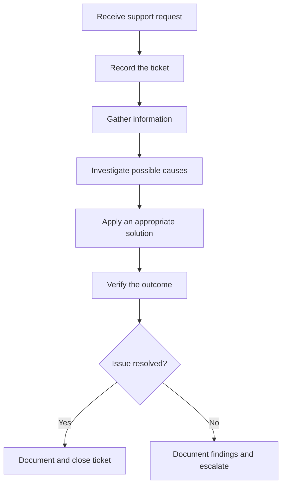

# IT Support Troubleshooting Workflow

## 1. Purpose

This workflow describes a structured process for handling IT support requests, from receiving a user report to resolving the issue or escalating it to another support team.

## 2. Troubleshooting Process

### Step 1: Receive the Request

- Record the reported problem.
- Create a ticket or update an existing ticket.
- Record the affected device, application, and user impact.
- Assess urgency and business impact to determine priority.

### Step 2: Gather Information

- Ask the user when the issue started.
- Identify what is affected and whether the issue is intermittent.
- Ask about recent changes or error messages.
- Record the user's answers.

### Step 3: Assess and Investigate

- Identify possible causes based on the available information.
- Start with simple, low-risk checks.
- Use appropriate diagnostic tools.
- Record observations and test results.

### Step 4: Apply a Suitable Solution

- Select an action supported by the findings.
- Follow organizational procedures and obtain authorization when needed.
- Explain any expected impact to the user.
- Record the action taken and its result.

### Step 5: Verify the Outcome

- Repeat the relevant test.
- Confirm whether the original symptoms remain.
- Ask the user to confirm that normal operation has resumed, where appropriate.

### Step 6: Resolve or Escalate

If the issue is resolved:

- Document the confirmed cause, if known.
- Record the solution and verification results.
- Update the ticket and close it according to the support process.

If the issue is not resolved:

- Record the remaining symptoms and tests performed.
- Escalate to the appropriate support team.
- Keep the ticket open or update its status according to the support process.

## 3. Workflow Diagram

## 4. Documentation Standards

Every ticket should distinguish between:

- User-reported symptoms.
- Technician observations.
- Tests performed and their results.
- Actions taken.
- Confirmed root cause, if established.
- Verification results.
- Escalation details, where applicable.

Do not record assumptions as confirmed facts.

## 5. Security and Professional Considerations

- Protect confidential user and organizational information.
- Obtain authorization before making changes that require it.
- Avoid unnecessary access to user data.
- Follow organizational security policies.
- Do not disable security controls as a routine troubleshooting shortcut.

## 6. Key Takeaway

Effective IT support combines systematic investigation, clear communication, safe troubleshooting, accurate documentation, and verification of the outcome.
